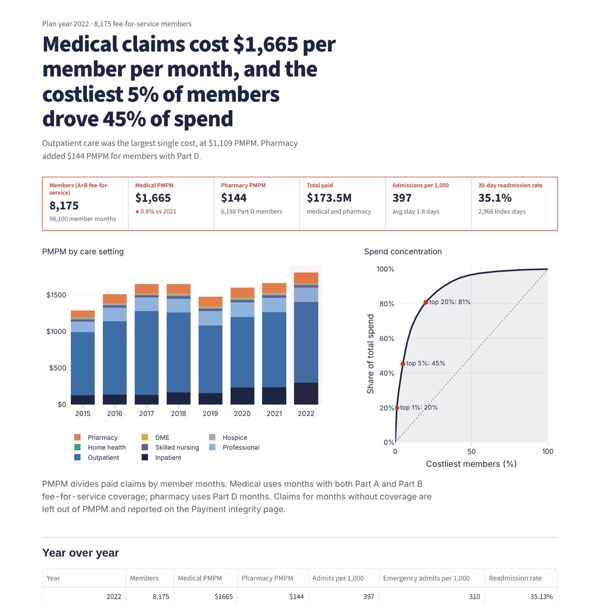
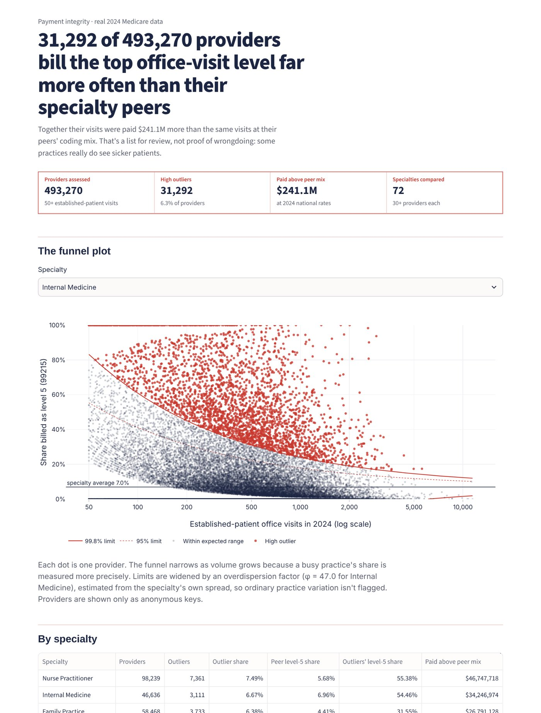
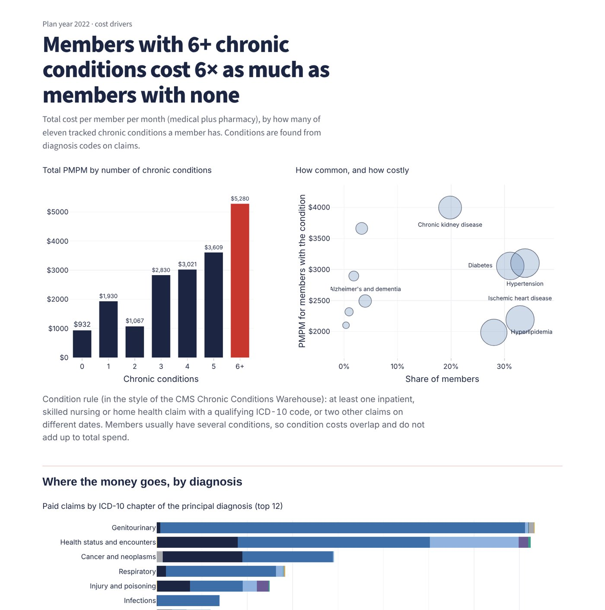
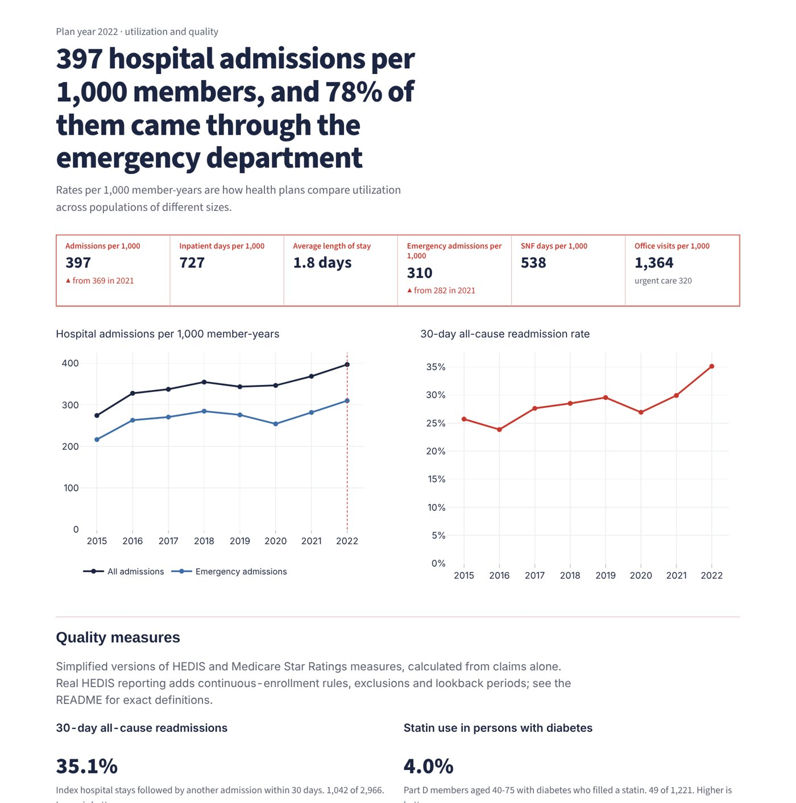
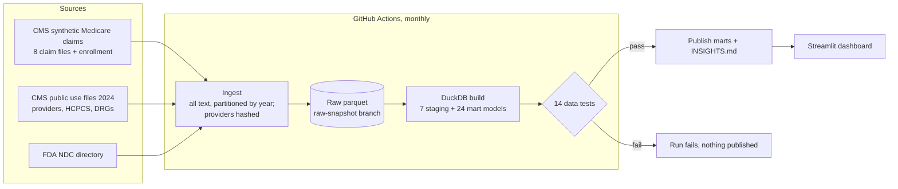

# ClaimLens

**Healthcare claims analytics and payment integrity.** A tested DuckDB claims warehouse built on CMS's synthetic Medicare claims, benchmarked against real 2024 Medicare data, with the metrics a health plan runs on: PMPM, utilization per 1,000, readmissions, chronic-condition burden, pharmacy and quality measures. It adds an E/M upcoding screen across **493,270 real US providers**.

[](https://github.com/AbdulSohail018/claimlens/actions/workflows/ci.yml)
[](https://github.com/AbdulSohail018/claimlens/actions/workflows/pipeline.yml)


### [▶ Open the live dashboard: claimlens-analytics.streamlit.app](https://claimlens-analytics.streamlit.app)

[](https://claimlens-analytics.streamlit.app)

## Why this project

Real patient claims are protected by HIPAA, so most portfolio projects in this space use toy data. ClaimLens uses two sources together:

| Source | What it is | Used for |
|---|---|---|
| **CMS Synthetic Medicare claims** | About 10,000 synthetic beneficiaries over 2015–2025, in CMS's own Research Identifiable File layout: enrollment, professional, outpatient, inpatient, SNF, home health, hospice, DME and Part D files. Realistic-but-not-real data, so there's no privacy risk. | The plan's members: eligibility, PMPM, utilization, conditions, pharmacy, quality, claim rule checks |
| **CMS Medicare public use files, 2024** | Real billing for every Medicare provider (3.2 GB), national prices per procedure code, and national payment per MS-DRG | Real-world benchmarks and the E/M coding-intensity screen |
| **FDA National Drug Code Directory** | Drug names and pharmacologic classes | Naming Part D drugs, statin and diabetes-drug flags |

## Findings

### Real 2024 Medicare data: office-visit coding intensity



- **31,292 of 493,270 providers (6.3%)** bill level-5 established-patient visits (99215) above the 99.8% funnel limit for their specialty.
- At 2024 national rates, their visits were paid **$241.1M more** than the same visits would have been at their specialty's coding mix. Nurse practitioners ($46.7M), internal medicine ($34.2M) and family practice ($26.8M) account for the most.
- The method matters. Providers vary far more than a binomial model expects: the overdispersion factor runs from 1 to 149 across specialties (Internal Medicine 47, Neurology 92). Without the correction, ordinary practice variation would be flagged as outliers at a far higher rate.
- Coding norms differ sharply by specialty: level 5 is 0.3% of dermatology visits and 23% of neurology visits. That's why every provider is compared only with their own specialty.
- 71% of providers never billed a 99215, while 5,393 billed nothing else.

> A high-outlier flag is a reason to review, not evidence of improper billing. Some practices really do treat sicker patients. Providers appear only as one-way hashed keys; names and addresses are dropped at ingest, and a data test fails the build if a raw NPI ever reaches the published data.

### The plan (synthetic members, plan year 2022)

| Metric | Value |
|---|---|
| Fee-for-service members | 8,175 (98,100 member months) |
| Medical PMPM | $1,665 (+8.8% vs 2021) |
| Pharmacy PMPM | $144 |
| Costliest 1% / 5% / 20% of members | 20% / 45% / 81% of spend |
| Admissions per 1,000 member-years | 397 (78% emergency admissions) |
| 30-day all-cause readmission rate | 35.1% |
| Members with 6+ chronic conditions | cost 6× as much per month as members with none |
| Claims outside covered months | 24,881 claims, $50.7M (5% of all paid), excluded from PMPM |

[INSIGHTS.md](INSIGHTS.md) is regenerated on every pipeline run.

| Cost drivers | Utilization and quality |
|---|---|
|  |  |

### What profiling the synthetic data found

Before trusting a metric, I profiled the raw files. Each finding changed how something is measured instead of being worked around silently:

- **Claims stop in early 2023 while enrollment runs to 2025.** Analysis years are capped at 2015–2022.
- **There are no death dates in any enrollment file.** The "service after death" rule is kept and documented, and it reports zero.
- **99.9% of outpatient revenue lines are code 0001** (the claim-total line), and there are **no ED or office E/M codes**. Emergency use is measured through admission type, and visits through place of service.
- **HbA1c lab codes never appear, and mammograms show up for only 44 member-years in 8 years.** Those measures are shown as *not measurable*, not as a misleading 0%.
- **Brand and generic fills split about 50/50**, against about 90% generic in real Part D, and **only 14% of drug codes match the FDA directory**, so the statin measure carries a visible "understated" caveat.
- **Synthetic payments don't track real prices.** The same procedure code ranges from 0.3× to 34× its real 2024 Medicare payment. Member-level dollars show the method; real-world dollar answers come from the 2024 CMS files.

## Architecture



- **Ingest** (`claimlens/ingest.py`) lands every CMS file as all-text parquet, partitioned by service year, so nothing is coerced before it can be inspected. The 3.2 GB provider file is reduced to office-visit rows at ingest.
- **Staging** (`sql/staging/`) builds a member-month **eligibility spine** from the 12 monthly entitlement, Medicare Advantage and Part D indicators. It also produces a single claim header across all seven settings, claim lines, a long diagnosis table (9M rows) and Part D fills.
- **Marts** (`sql/marts/`) answer specific questions: PMPM, cost concentration, conditions, comorbidity, admissions and readmissions, utilization, DRGs, diagnosis chapters, pharmacy, quality, integrity rules, price calibration and the E/M funnel.

## Data-quality tests

Each test in `sql/tests/` returns the rows that break a rule. The pipeline publishes only if all pass.

| Test | Rule |
|---|---|
| `pmpm_reconciles` | Medical spend in the PMPM mart equals eligible paid claims in staging, to the cent |
| `member_cost_reconciles` | Member-level cost adds back up to the PMPM mart |
| `claims_unique`, `claim_lines_unique`, `pde_unique`, `member_month_unique` | No duplicated keys |
| `claims_have_member` | Every claim and fill belongs to an enrolled beneficiary |
| `claim_dates_valid` | Service dates exist, fall in range, and don't end before they start |
| `icd10_format`, `hcpcs_format` | At least 99% of codes are well-formed ICD-10-CM and CPT/HCPCS |
| `member_months_bounded` | 1–12 covered months per member per year |
| `rates_in_range`, `em_shares_sum_to_one` | Rates fall between 0 and 1; visit-level shares sum to 1 |
| `no_npi_in_published_marts` | **Privacy:** no raw 10-digit NPI in published provider data |

The unit tests (`tests/`) build every model on a small fixture in the exact CMS file layout, with known answers for each rule. During development they caught a bug where stays with no later admission counted as NULL instead of "not readmitted". That would have reported a readmission rate of 100% instead of 50% on the fixture.

## Methods

- **Member month**: Part A and B fee-for-service coverage (buy-in 3 or C, not Medicare Advantage) while alive. Part D months are counted separately.
- **PMPM**: paid claims ÷ member months. Claims in uncovered months are excluded and reported as findings.
- **Per 1,000**: events ÷ member-years × 1,000.
- **Readmission**: acute admission 1–30 days after an index discharge. Index stays exclude deaths, transfers and discharges against medical advice, and need a full 30-day follow-up window inside the data, so the final year isn't understated. Planned readmissions are not removed.
- **Chronic conditions**: 11 ICD-10 groups, using a Chronic Conditions Warehouse-style rule (one facility claim, or two other claims on different dates).
- **E/M funnel**: for each specialty with 30+ providers, the peer level-5 share *p₀*. A provider is a high outlier if *z* / √φ > 3.09, where *z* is the binomial z-score and φ is a multiplicative overdispersion factor estimated from 10%/90% winsorized z-scores (Spiegelhalter, 2005). "Paid above peer mix" prices the provider's visits at 2024 national rates under their own level mix and under the specialty mix.

## Run it

```bash
git clone https://github.com/AbdulSohail018/claimlens.git
cd claimlens
python -m venv .venv && source .venv/bin/activate     # Windows: .venv\Scripts\activate
pip install -r requirements.txt

streamlit run app/streamlit_app.py            # dashboard on the published marts (no download needed)
# or open the hosted copy: https://claimlens-analytics.streamlit.app

python -m claimlens.ingest                    # download CMS + FDA sources (~3.5 GB; 36 s on GitHub runners)
python -m claimlens.warehouse --test --export # build, test, publish marts
python -m claimlens.insights                  # regenerate INSIGHTS.md
pip install pytest && pytest                  # unit tests, offline
```

To skip the download, fetch the raw parquet snapshot the pipeline keeps on the `raw-snapshot` branch:

```bash
git fetch origin raw-snapshot && git archive FETCH_HEAD data/raw | tar -x
```

## Project layout

```
claimlens/
├── claimlens/        # ingest, warehouse builder, insights, sources and config
├── sql/
│   ├── staging/      # eligibility spine, claims, lines, diagnoses, Part D, drugs
│   ├── marts/        # PMPM, utilization, quality, pharmacy, integrity, E/M funnel
│   └── tests/        # 14 data-quality tests
├── app/              # Streamlit dashboard (6 pages)
├── data/marts/       # published marts read by the dashboard
├── tests/            # fixture in CMS RIF layout + unit tests
└── .github/workflows # monthly pipeline and CI
```

## Data sources and terms

- CMS Synthetic Medicare Enrollment, Fee-for-Service Claims, and Prescription Drug Event data (data.cms.gov). CMS notes the files "have very limited inferential research value". They are used here to demonstrate method, not to draw conclusions about Medicare beneficiaries.
- CMS Medicare Physician & Other Practitioners and Medicare Inpatient Hospitals public use files, 2024 (data.cms.gov).
- FDA National Drug Code Directory (accessdata.fda.gov).

ClaimLens is an independent portfolio project and is not affiliated with CMS or the FDA.

## License

MIT
